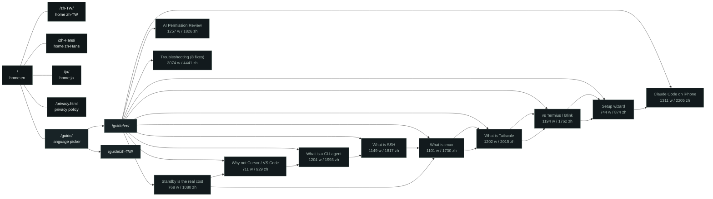

# Site map

Generated by `guide-src/site_map.py`. Re-run it after changing `config.json`:
`python3 guide-src/site_map.py`.

```text
agentmux.saxcave.cc
├─ /                  home (en, x-default)
├─ /zh-TW/            home zh-TW
├─ /zh-Hans/          home zh-Hans
├─ /ja/               home ja
├─ /privacy.html      privacy policy
└─ /guide/            language picker (redirects by preference)
   └─ /guide/zh-TW/  11 articles
      ├─ why-remote-vibe-coding/  [BC] 768 w / 1080 zh
      ├─ why-not-gui-ide/         [B] 711 w / 929 zh
      ├─ what-is-cli/             [B] 1204 w / 1993 zh
      ├─ what-is-ssh/             [B] 1149 w / 1817 zh
      ├─ what-is-tmux/            [BC] 1101 w / 1730 zh
      ├─ what-is-tailscale/       [BC] 1202 w / 2015 zh
      ├─ why-agentmux/            [BC] 1194 w / 1762 zh
      ├─ setup/                   [BC] 744 w / 874 zh
      ├─ claude-code-on-iphone/   [C] 1311 w / 2205 zh
      ├─ permission-review/       [-] 1257 w / 1826 zh
      └─ troubleshooting/         [-] 3074 w / 4441 zh
   └─ /guide/en/  11 articles
      ├─ why-remote-vibe-coding/  [BC] 768 w / 1080 zh
      ├─ why-not-gui-ide/         [B] 711 w / 929 zh
      ├─ what-is-cli/             [B] 1204 w / 1993 zh
      ├─ what-is-ssh/             [B] 1149 w / 1817 zh
      ├─ what-is-tmux/            [BC] 1101 w / 1730 zh
      ├─ what-is-tailscale/       [BC] 1202 w / 2015 zh
      ├─ why-agentmux/            [BC] 1194 w / 1762 zh
      ├─ setup/                   [BC] 744 w / 874 zh
      ├─ claude-code-on-iphone/   [C] 1311 w / 2205 zh
      ├─ permission-review/       [-] 1257 w / 1826 zh
      └─ troubleshooting/         [-] 3074 w / 4441 zh
```

B = beginner track, C = CLI-user track.

## Mermaid



Locales: `/`, `/zh-TW/`, `/zh-Hans/`, `/ja/`. The guide exists in en and zh-TW only; `/en/` is a redirect to `/`.
